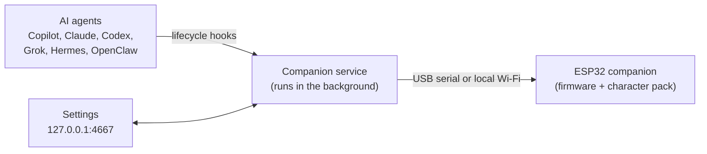
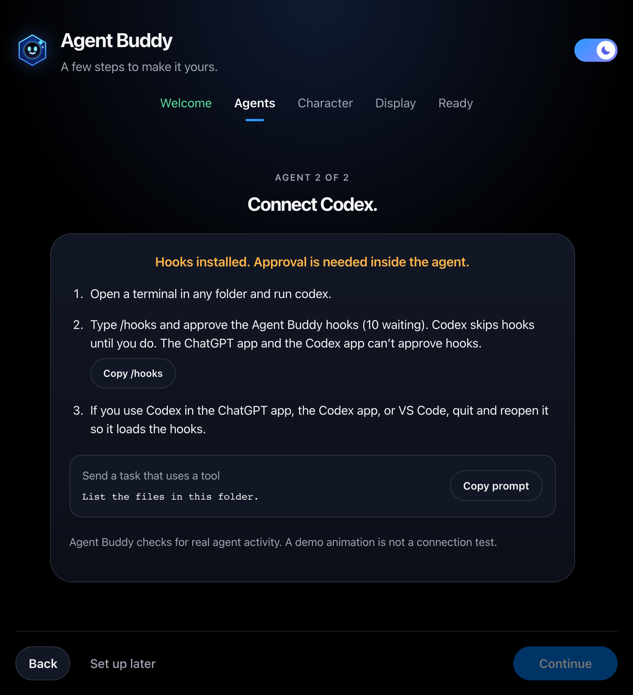
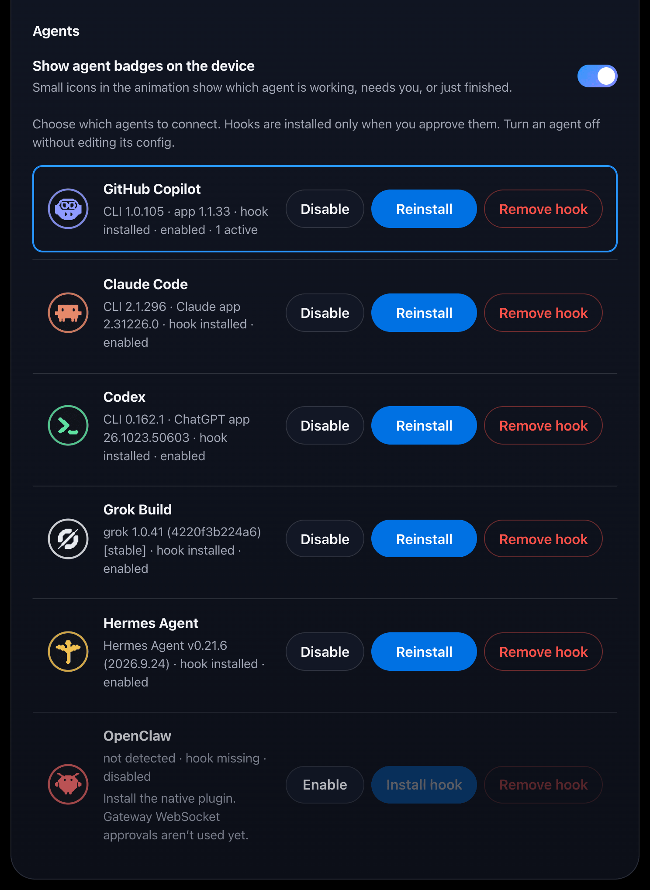
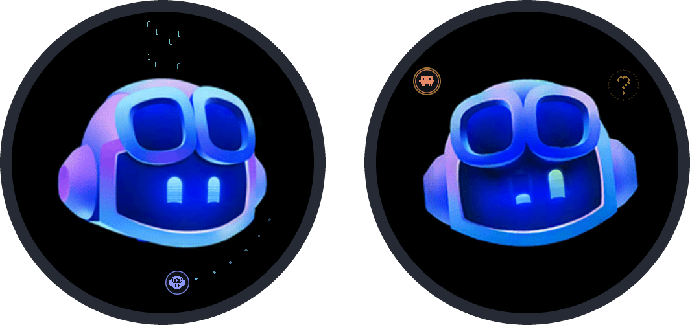
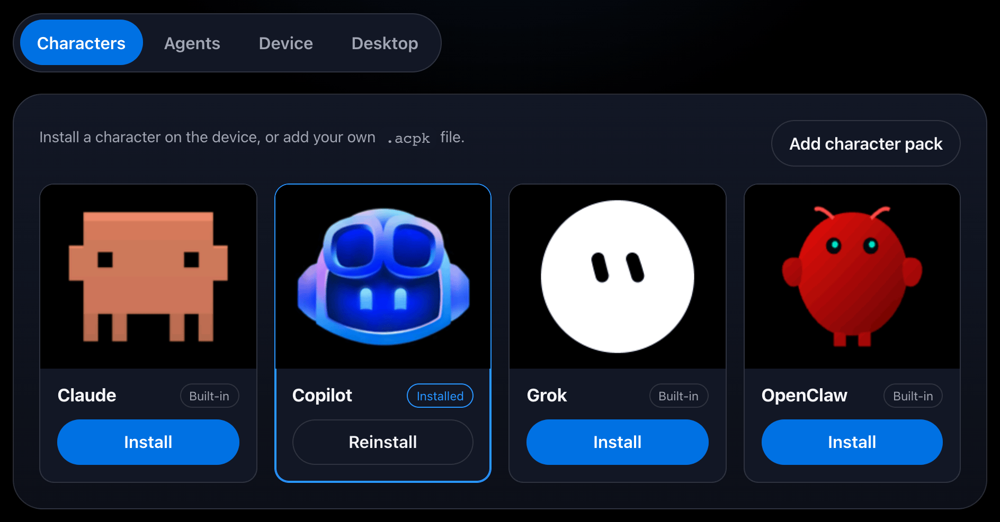
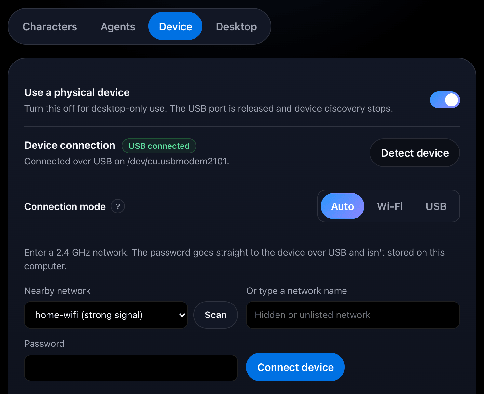
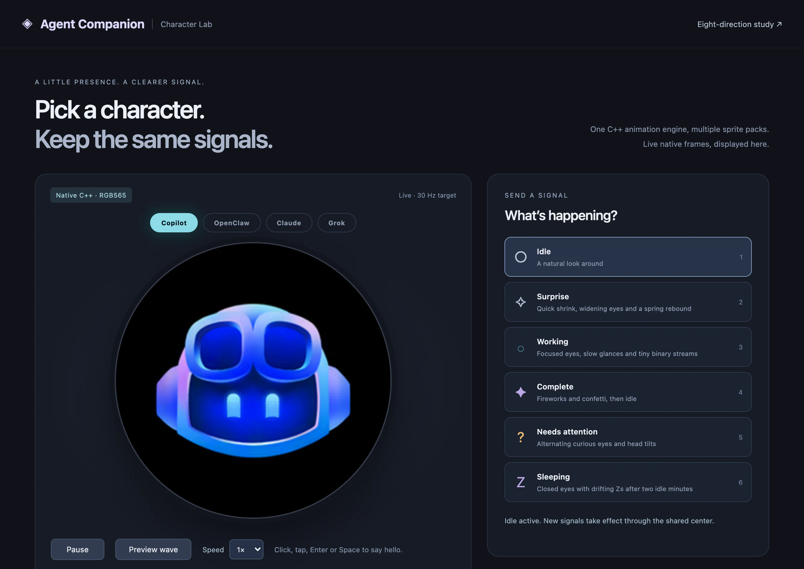

<p align="center">
  
</p>

<h1 align="center">Agent Buddy</h1>

<p align="center">
  An animated desk companion that shows what your AI coding agents are doing.
</p>

<p align="center">
  <a href="https://github.com/DanWahlin/agent-buddy/releases/latest"></a>
  <a href="https://github.com/DanWahlin/agent-buddy/actions/workflows/build.yml"></a>
</p>

[Agent Buddy](https://getagentbuddy.com) works with the
[Waveshare ESP32-S3-Touch-AMOLED-1.75-B or -C](https://www.amazon.com/dp/B0FBWDL117)
and turns it into a character that reacts to your AI coding agents. When GitHub Copilot,
Claude Code, Codex, Grok Build, Hermes Agent, or OpenClaw starts working,
needs your approval, or finishes, the character shows it, along with a small
badge for the agent involved.

Everything runs locally. There's no cloud service, account, or subscription, and
the device works over USB or your local Wi-Fi.

Want it on your screen as well? The [Desktop Agent Buddy](#desktop-agent-buddy)
puts the same character, with the same animation, in a transparent window on your
desktop, with or without the device.

<p align="center">
  
</p>

<p align="center">
  <a href="https://getagentbuddy.com"><strong>Website</strong></a>
</p>

## Contents

- [Features](#features)
- [How it works](#how-it-works)
- [What you need](#what-you-need)
- [Quick start](#quick-start)
- [Step 1: Flash the firmware](#step-1-flash-the-firmware)
- [Step 2: Install the companion service](#step-2-install-the-companion-service)
- [Step 3: Finish setting up your agents](#step-3-finish-setting-up-your-agents)
- [Step 4: Try it](#step-4-try-it)
- [Using the device](#using-the-device)
- [Agents](#agents)
- [Agent badges](#agent-badges)
- [AI credits and tokens](#ai-credits-and-tokens)
- [Characters](#characters)
- [Wi-Fi](#wi-fi)
- [Update](#update)
- [Command reference](#command-reference)
- [Troubleshooting](#troubleshooting)
- [Desktop Agent Buddy](#desktop-agent-buddy)
- [Develop and customize](#develop-and-customize)

## Features

- **Agent-aware states:** Working, Needs attention, and Complete animations driven
  by your agents' lifecycle hooks, with sessions from several agents combined.
- **Agent badges:** small icons show which agent is working, waiting on you, or
  just finished.
- **Usage:** GitHub Copilot AI credits (`AIC`) and agent tokens, at the bottom
  of the screen.
- **Six supported agents:** GitHub Copilot, Claude Code, Codex, Grok Build,
  Hermes Agent, and OpenClaw.
- **Swappable characters:** the device holds one character at a time. It comes
  with Copilot, and you can install OpenClaw, Claude, Grok, a pack from the
  [character gallery](https://getagentbuddy.com/gallery.html), or your own, over
  USB or Wi-Fi.
- **Settings:** a local web page for agents, badges, characters, Wi-Fi, the
  connection mode, and the desktop app, with light and dark themes.
- **Natural motion:** eight looking directions, blinks, touch reactions, and a
  sleep cycle after two idle minutes.
- **Automatic orientation:** the onboard accelerometer keeps the screen and the
  touch controls upright when you rotate the device.
- **Wi-Fi or USB:** run it tethered to your computer or from any USB power source
  on the same network.
- **Optional sound:** short local sound cues through the board's speaker connector,
  and the same cues from the desktop app when you turn them on.

## How it works



1. **Firmware** runs the animation on the device. Install it from the desktop
   app, or flash it from a release.
2. **Hooks** in each agent's config report events such as "started a tool",
   "needs permission", and "finished".
3. **The companion service** runs in the background on your computer. It
   combines those events into one state, sends it to the device, and serves
   Settings.

## What you need

| Item | Details |
| --- | --- |
| Device | **Waveshare ESP32-S3-Touch-AMOLED-1.75-B or 1.75-C** from [Amazon](https://www.amazon.com/dp/B0FBWDL117) or [Waveshare](https://www.waveshare.com/esp32-s3-touch-amoled-1.75.htm?sku=31262). The **Waveshare ESP32-S3-Touch-LCD-1.54** also works. Other ESP32 displays need their own board target ([Boards](docs/development.md#boards)). |
| Cable | A USB data cable (charge-only cables won't work) |
| Computer | macOS, Linux, or Windows (x64 or Arm64). On Windows, the desktop app runs the companion service natively, and agents in [WSL 2](#windows-wsl-2) use it too. |
| Python | Only to flash the firmware without the desktop app: [3.10 or newer](https://www.python.org/downloads/). The `python3` that comes with macOS is too old. |
| Node.js and Git | Only to run the companion service from the repository: [Node.js 24 LTS](https://nodejs.org/) (24.11 or newer) and Git. The desktop app carries its own. |
| Speaker (optional) | A small two-pin speaker, if your board or enclosure doesn't include one |
| Desktop app | Nothing extra to download and run it. To build it from source, install [Rust](https://rustup.rs/) 1.90 or newer and the OS build dependencies. |

## Quick start

**With the desktop app (recommended).** You need only the app. You don't need
Python, Node.js, or a clone of the repository.

<a id="install-with-a-coding-agent"></a>
**Let a coding agent install it (optional).** Any coding agent that can run
commands on your computer can download, install, and open the app for you.
Paste the prompt below into an interactive session, so that you can approve
each command. When the welcome screen opens, select **Get Started**, then
continue at step 3.

<details>
<summary><strong>Prompt to install the desktop app</strong></summary>

```text
Install the latest Agent Buddy desktop app on this computer from
https://github.com/DanWahlin/agent-buddy/releases/latest
The GitHub API lists the files of that release and their download links:
https://api.github.com/repos/DanWahlin/agent-buddy/releases/latest

1. Find my OS and CPU. On Windows, check the CPU of the computer, not of
   your process: Windows 11 on ARM also runs x64 programs, and they report
   x64. (Get-CimInstance Win32_Processor).Architecture is 12 on an ARM PC.
2. Download the matching file from that release:
   - macOS 11 or later (Apple Silicon or Intel): agent-companion-desktop-<version>-macos-universal.dmg
   - Windows x64: agent-companion-desktop-<version>-windows-x64-setup.exe
   - Windows on ARM: agent-companion-desktop-<version>-windows-arm64-setup.exe
   - Debian, Ubuntu, or another Linux that uses apt (x86_64): agent-companion-desktop-<version>-linux-amd64.deb
   - Other Linux (x86_64): agent-companion-desktop-<version>-linux-x86_64.AppImage
   If no file matches, such as for Linux on ARM or an older macOS, stop and
   tell me.
3. Check the file against SHA256SUMS from the same release. If it doesn't
   match, stop and tell me.
4. If Agent Buddy is running, quit it. Then install the file:
   - macOS: move an older /Applications/Agent Buddy.app to the Trash. Copy
     Agent Buddy.app from the DMG to /Applications, and eject the DMG.
     Remove the com.apple.quarantine attribute from the app if it has one.
   - Windows: start the setup program, and let me finish it.
   - .deb: sudo apt install ./<file>
   - AppImage: put it in a permanent folder, such as ~/Applications, and make
     it executable. If it asks for FUSE, install FUSE 2.
5. Open the app so that it keeps running after your command ends. Then stop:
   I finish setup in the app.

Don't install agent hooks or change agent settings. The app does that after
I approve it. If you can't download or install the file, tell me the commands
to run.
```

</details>

1. Download the app for your OS from
   [Releases](https://github.com/DanWahlin/agent-buddy/releases/latest): the
   `.dmg` for macOS, a `-setup.exe` for Windows (x64 or ARM64), or the
   `.AppImage` or `.deb` for Linux.
2. Open the app. The macOS and Linux apps aren't code-signed, so they need one
   first-run step ([Run the desktop app](#run-the-desktop-app)). A new
   installation starts the companion service and opens the welcome screen:
   select **Get Started**.
3. Select your agents, and approve the hook changes that they need. Follow each
   agent's short guide, which waits for real agent activity, or select
   **Set up later**. On Windows, the app also finds agents in running WSL
   distributions ([details](#windows-wsl-2)).
4. Select a character.
5. Select **Desktop only**, **Device only**, or **Both**. For a new device,
   connect a USB data cable, select **Detect Device**, and confirm the Waveshare
   model. The app downloads, checks, and installs the matching firmware, then
   your character. You can keep compatible firmware, or select
   **Use desktop for now**.
6. Select **Finish** to open Settings. To open it later, use the app's menu bar
   or tray icon, or right-click the desktop character. To untether the device,
   set up Wi-Fi on the **Device** tab.

<details>
<summary><strong>More about setup</strong></summary>

- Setup resumes after an interruption, and an update doesn't start it again. To
  change your choices or finish a step that you put off, use **Run setup wizard**
  in Settings.
- **Set up later** doesn't mark an agent as connected. If an agent already has
  hooks, clearing its check box asks before Agent Buddy removes them. Agent Buddy
  never uninstalls the coding agent itself.
- If you run setup again with a device on Wi-Fi, you can keep its firmware and
  install your character over Wi-Fi. The first firmware installation needs USB.
- To repair or replace the firmware later, turn on **Use a physical device** on
  the **Device** tab, open **USB release install or recovery**, select the
  device, and approve **Install v&lt;version&gt;**.

</details>

**Without the desktop app** (to change the code, or to run everything inside
WSL 2): flash the firmware with `flash.py` ([Step 1](#step-1-flash-the-firmware)),
then run the companion service from a clone of this repository
([Step 2](#step-2-install-the-companion-service)).

Restart any agent sessions that were already open, then start one and watch the
character react ([Step 4](#step-4-try-it)).

## Step 1: Flash the firmware

Use these steps on a computer without the desktop app, which installs the
firmware for you ([Quick start](#quick-start)). You don't need Arduino tools or
the source code. To build the firmware yourself, see
[Build from source](docs/build-from-source.md).

1. Check that you have Python 3.10 or newer:

   ```bash
   python3 --version      # Windows PowerShell: py -3 --version
   ```

   The `python3` that comes with macOS is 3.9. If that's what you see, install a
   newer Python from [python.org](https://www.python.org/downloads/) or with
   `brew install python`, then open a new terminal and check again.

2. From [Releases](https://github.com/DanWahlin/agent-buddy/releases/latest),
   download `agent-buddy-v<version>-firmware.zip` and extract it. For the
   Waveshare ESP32-S3-Touch-LCD-1.54, download
   `agent-buddy-v<version>-waveshare-lcd-154-firmware.zip` instead. Never flash
   one board's firmware to a different board.
3. Open a terminal in the extracted folder (it contains `flash.py`) and install
   the flashing tool:

   **macOS / Linux**

   ```bash
   python3 -m venv .venv
   .venv/bin/python -m pip install -r requirements.txt
   ```

   **Windows PowerShell**

   ```powershell
   py -3 -m venv .venv
   .\.venv\Scripts\python.exe -m pip install -r requirements.txt
   ```

4. Connect the device with the USB data cable, find its port, and flash it:

   **macOS / Linux**

   ```bash
   .venv/bin/python flash.py --list-ports
   .venv/bin/python flash.py --port /dev/cu.usbmodem2101
   ```

   **Windows PowerShell**

   ```powershell
   .\.venv\Scripts\python.exe flash.py --list-ports
   .\.venv\Scripts\python.exe flash.py --port COM5
   ```

   Use the port that `--list-ports` shows for your board. macOS ports look like
   `/dev/cu.usbmodem…`, and Linux ports look like `/dev/ttyACM0`. Type `FLASH`
   when prompted.

When it finishes, the device restarts and the Copilot character starts looking
around. Leave the cable plugged in for the next step.

> [!WARNING]
> Flashing replaces the board's existing firmware and partition table. Back up
> anything you need from its previous firmware first.

<details>
<summary><strong>Flashing troubleshooting</strong></summary>

- **The device isn't listed:** make sure the cable carries data, and close any
  serial monitor that's using the port.
- **"Python 3.10 or newer is required":** the environment was created with an
  older Python. Recreate it with a newer one, for example
  `python3.13 -m venv --clear .venv`, and install the requirements again.
- **Linux can't create the environment:** install your distribution's
  `python3-venv` package.
- **Download mode or connection problems:** see the
  [Waveshare board guide](https://www.waveshare.com/wiki/ESP32-S3-Touch-AMOLED-1.75).
- Don't flash the application `.bin` on its own or mix files from different
  releases. `flash.py` writes the matched set at the right addresses.

</details>

## Step 2: Install the companion service

The companion service connects your agents to the device and runs in the
background. The desktop app installs it for you. Without the app, plug in the
device over USB, clone this repository, and run setup:

```bash
git clone https://github.com/DanWahlin/agent-buddy.git
cd agent-buddy
npm run setup
```

Setup installs a hook for each agent it finds on your computer, then starts the
companion service in the background (a macOS LaunchAgent or a Linux systemd user
service), so it starts whenever you sign in. When it's done, it opens Settings.

Check that the service found the device:

```bash
npm run status
```

You should see `Connected over USB`. If it says no device is connected, see
[Troubleshooting](#troubleshooting).

Restart any agent sessions that were already open so they load the new hooks.

> [!TIP]
> The service saves your shell's `PATH` so it finds the same agents you do. If
> you install a new agent later, run `npm run setup` again.

<details>
<summary><strong>Linux: serial port permission errors</strong></summary>

This applies to the desktop app too. Add your user to the `dialout` group, then
sign out and back in:

```bash
sudo usermod -aG dialout "$USER"
```

</details>

<a id="windows-wsl-2"></a>
<details>
<summary><strong>Windows (WSL 2)</strong></summary>

The easiest way on Windows is the desktop app (see [Quick start](#quick-start)).
Its companion service runs on Windows and uses the device's USB port with no
extra steps. After you approve it, the app installs the hooks of the agents that
you select on Windows and in running WSL 2 distributions. The OpenClaw plugin
doesn't connect from WSL yet.

Setup looks for agents only in running distributions, so open a stopped
distribution before you select **Rescan agents**. A Windows program that WSL
finds under a drive such as `/mnt/c` doesn't count as an agent of the
distribution.

To run the companion service from a clone inside WSL instead, run your agent CLIs
and the service **inside the same WSL 2 distribution**. Hooks installed in WSL
can't see agents that run natively on Windows.

1. Install Node.js 24 LTS inside WSL.
2. If systemd isn't enabled, add this to `/etc/wsl.conf`, then run `wsl --shutdown`
   from PowerShell and reopen WSL:

   ```ini
   [boot]
   systemd=true
   ```

3. Windows doesn't share USB devices with WSL automatically. Install
   [`usbipd-win`](https://learn.microsoft.com/windows/wsl/connect-usb), connect
   the device, and run this in PowerShell:

   ```powershell
   usbipd list
   # Once, in an Administrator PowerShell, using the ESP32's BUSID:
   usbipd bind --busid <BUSID>
   # Each time you want to use the device from WSL:
   usbipd attach --wsl --busid <BUSID>
   ```

4. In WSL, confirm that `/dev/ttyACM*` or `/dev/ttyUSB*` exists, then follow the
   Linux steps above. While the device is attached to WSL, Windows apps can't use it.

The Settings link opens in your Windows browser.

</details>

## Step 3: Finish setting up your agents

Setup opens Settings for you. To open it again later, run:

```bash
npm run settings
```

Settings runs only on your computer and needs the private link that
`npm run settings` opens, so other websites and devices can't reach it. The link
survives restarts, so you can bookmark it.

Some agents need a one-time step before their hooks run, such as approval with
`/hooks` in the Codex CLI, folder trust in Claude Code, or a Gateway restart in OpenClaw.
Desktop setup shows one guide per selected agent. Hermes can request approval
when each event type first runs; one received event does not approve every hook.

In Settings, expand **Finish connecting your agents** to see outstanding steps.
Select **Open setup guides** to continue. The app distinguishes installed hooks
from agent approval and received activity.

The guides check all six supported agents automatically. Run the displayed test
task in the agent. The guide updates when Agent Buddy receives real activity
and the required approval is complete.

<p align="center">
  
</p>

## Step 4: Try it

Start a new session in one of your agents and ask it to do something that uses a
tool, such as reading a file. The character should:

1. Switch to **Working** while the agent runs.
2. Switch to **Needs attention** if the agent asks for your permission.
3. Celebrate with **Complete** when the turn finishes, then return to **Idle**.

The Settings overview shows the current state and which agent is
driving it. Device address, network, and version information are in
**Connection details and versions**. Select the **Device** tab to change
**Connection mode** between Auto, Wi-Fi, and USB. If the character doesn't react, see
[Troubleshooting](#troubleshooting).

## Using the device

The character works as soon as it's flashed, even without the companion service.

| State | What you'll see | Triggered by |
| --- | --- | --- |
| Idle | Looks around and blinks | No agent activity |
| Working | Focused eyes, orbiting dots, and drifting binary digits | An agent is running a turn or tool |
| Needs attention | Curious head tilts and an amber question mark | An agent is waiting for permission or input |
| Complete | A short celebration | An agent finished a turn that used tools |
| Surprise | A quick spring-like recoil | Tapping the character |
| Sleep | Drowsy eyelids and drifting Zs | Two uninterrupted idle minutes; wakes after one minute |

**Swipe up** to open the on-device settings menu. Swipe down or select **Close**
to return to the character. The menu also closes on its own after 30 seconds
without a touch.

| Control | What it does |
| --- | --- |
| Wi-Fi status (top) | Shows the connection and network name. Tap it for network details and **Setup Wi-Fi**. |
| Brightness | Adjusts display brightness |
| Volume | Sets sound from Off to 100% (default 50%, remembered across restarts) |
| Character | Shows the installed character |
| Character state | Previews Idle, Working, Complete, Needs attention, or Surprise |

**Press the BOOT button** on the board to open the companion's Settings on your
computer. This needs the companion service, connected over USB or Wi-Fi (over
Wi-Fi, it can take up to three seconds). If the [desktop app](#desktop-agent-buddy)
is running, Settings opens in its window. If not, Settings opens in your browser.
Don't use the PWR button for this: holding it turns the board off.

Sound plays through the board's two-pin speaker connector. Connect a small speaker
if your board or enclosure doesn't include one. The [desktop app](#desktop-agent-buddy)
can play the same sounds through your computer; the device's volume does not
change them.

## Agents

Command-line setup installs hooks for the agents that it finds. Desktop setup
installs only the hooks that you select and approve, and it lists the files that
it changes. Hooks notify the companion service. If the service or the device
isn't running, your agents still work.

| Agent | Hook location | One-time step |
| --- | --- | --- |
| GitHub Copilot (CLI and app) | `~/.copilot/hooks/agent-companion.json` | None |
| Claude Code (CLI, Claude app, and IDEs) | `~/.claude/settings.json` | Accept Claude's folder-trust prompt if it asks |
| Codex (CLI, ChatGPT app, and VS Code) | `~/.codex/hooks.json` | Approve the hooks with `/hooks` in the Codex CLI |
| Grok Build | `~/.grok/hooks/agent-companion.json` | None |
| Hermes Agent | `~/.hermes/config.yaml` (Windows: `%LOCALAPPDATA%\hermes\config.yaml`) | Approve each hook the first time Hermes runs it |
| OpenClaw | A plugin registered with the `openclaw` CLI | Restart the OpenClaw Gateway |

The **Agents** tab in Settings lists every supported agent with its version and
hook status. An agent that drives the display is highlighted.

<p align="center">
  
</p>

| Control | What it does |
| --- | --- |
| **Disable** / **Enable** | Stops or resumes that agent's control of the device, without touching its config |
| **Install hook** / **Reinstall** | Writes (or rewrites) the hook into the agent's config |
| **Remove hook** | Removes only this project's hook from the agent's config |

A hook status of **outdated** means the hooks run another copy of the companion
(for example, a repository install instead of the desktop app), a Node.js or
companion file that no longer exists, or not all of the events. Choose
**Reinstall** to fix it.

If you remove an agent's hook, it stays removed. Setup and desktop app updates
don't add it back until you choose **Install hook** or run
`npm run agents install <agent>`.

The same actions are available from the command line:

```bash
npm run agents                     # List agents, versions, and hook status
npm run agents disable claude      # Stop an agent from driving the device
npm run agents enable claude
npm run agents install codex       # Install or reinstall one hook
npm run agents uninstall codex     # Remove one hook
```

<details>
<summary><strong>How agent events become device states</strong></summary>

- Active agent or subagent work maps to **Working**.
- Permission and input prompts, and errors that end a turn, map to
  **Needs attention**, which takes priority over every other session. Prompts
  from one-shot runs (`copilot -p`, `claude -p`, `codex exec`, `grok -p`, and
  `hermes -z`) are ignored, because no one can answer them.
- A finished turn that used tools maps to **Complete**.
- Inactive sessions return to **Idle**.

Sessions from different agents and terminals are tracked separately, so one agent
finishing doesn't hide another that's still working.

</details>

<details>
<summary><strong>Hook details</strong></summary>

- **Your files.** Setup edits only the hook entries that it owns. Before it
  changes a file, it keeps a copy beside it: `<file>.bak` holds the file as it
  was before the first change, and `<file>.agent-companion-<time>.bak` holds it as
  it was before each change (the last five are kept). It doesn't touch a file
  that has nothing to change, and it stops without changes if a file's `hooks`
  section is in a format that it doesn't understand.
- **Moved settings folders.** If you moved an agent's settings folder with its
  own variable (`COPILOT_HOME`, `CLAUDE_CONFIG_DIR`, `CODEX_HOME`, `GROK_HOME`,
  `HERMES_HOME`, or `OPENCLAW_HOME`), setup uses that folder instead of the one
  in the table. Set the variable in your shell's startup file (for example,
  `~/.zshrc` or `~/.bashrc`): the service and the desktop app read it from there.
  If you change it later, run setup again, or open a newer version of the
  desktop app.
- **Windows.** Codex and Grok run their hooks in PowerShell, so setup writes the
  hook command in the PowerShell form
  (`& 'node.exe' 'cli.js' hook <agent> <event>`). After an update from an older
  version, Settings shows these hooks as outdated. Click **Reinstall**, and then
  approve the Codex hooks again with `/hooks`.
- **Codex approvals.** Codex links each hook approval to the hook's position in
  `~/.codex/hooks.json`. If removing or reinstalling the companion's hook moves
  one of your own approved Codex hooks, Settings and `npm run agents` show a
  warning that names it. Run `codex` in a terminal, type `/hooks`, and approve
  it again.
- **Hermes.** Removing a Hermes hook doesn't revoke its approval. To clean that
  up too, run `hermes hooks revoke "<command>"` with the command shown in its
  config.
- **Grok and the Claude hooks.** Grok also runs the hooks in Claude's settings.
  If you use both, Grok can show a line such as
  `PreToolUse hook (global/settings) failed, ignored` for the Agent Buddy Claude
  hook. This doesn't change the display, because Grok's own hook sends the
  events. To stop the message, add this to `~/.grok/config.toml`. Grok then
  skips all of your Claude hooks, not only this one:

  ```toml
  [compat.claude]
  hooks = false
  ```

</details>

### Desktop apps

Some desktop apps run an agent with the same settings folder as its CLI, so they
use the same hooks. Setup finds these apps too, and Settings shows the version
of each CLI and app that it finds.

- **GitHub Copilot app** runs its own Copilot CLI with `~/.copilot`, so one hook
  file covers the CLI and the app.
- **Claude app** (the Code tab) uses `~/.claude`. After setup, quit and reopen
  the app, then start a new session in the Code tab. Cowork, cloud, and SSH
  sessions don't run the hooks on your computer. If a Code tab session doesn't
  move the character, quit and reopen the app: sometimes it starts a session
  without its hooks
  ([anthropics/claude-code#87657](https://github.com/anthropics/claude-code/issues/87657)).
- **ChatGPT app and Codex in VS Code** use `~/.codex`. The hooks need Codex
  0.148.0 or later, and Settings tells you when a Codex that you use is older.
  Approve the hooks with `/hooks` in the Codex CLI, in a terminal: in the
  ChatGPT app, `/hooks` is only a chat message. Then quit and reopen the app,
  because it reads hook approvals only when it starts.

<details>
<summary><strong>More about Codex and the desktop apps</strong></summary>

- The ChatGPT app replaced the Codex app. The Agent Buddy hooks run in the
  background (async hooks), so an older Codex skips them and doesn't show them
  in `/hooks`.
- If you don't have the Codex CLI, the setup guide shows the command for the CLI
  that the ChatGPT app includes (on Windows, a PowerShell command). If that CLI
  is older too, the guide tells you to install the Codex CLI
  (`npm install -g @openai/codex`).
- Each place approves only its own hooks. For hooks in a WSL distribution, run
  `codex` in that distribution.
- Settings checks the Codex CLI, the Codex in the ChatGPT app, the Codex
  extension in VS Code, VS Code Insiders, Cursor, and Windsurf (also in a remote
  window, such as one in WSL), and the `codex` in each WSL distribution. An
  editor counts while it is installed, and a remote window while you still open
  it (its extensions changed in the last 30 days).
- On macOS, the Copilot card shows the version of the CLI and of the app.

| System | Where setup looks | The CLI that the ChatGPT app includes |
| --- | --- | --- |
| macOS | `/Applications` and `~/Applications` | `/Applications/ChatGPT.app/Contents/Resources/codex-cli/bin/codex` (in an older app, `/Applications/ChatGPT.app/Contents/Resources/codex`) |
| Windows | Microsoft Store and MSIX apps, `%LOCALAPPDATA%\Programs`, `%LOCALAPPDATA%\AnthropicClaude`, and `%ProgramFiles%\GitHub Copilot` | `& 'C:\Program Files\WindowsApps\OpenAI.Codex_<version>_<arch>__2p2nqsd0c76g0\app\resources\codex.exe'` (PowerShell) |
| Linux | `/usr/lib` and `/opt` (`.deb`, `.rpm`, and Arch packages) | `/usr/lib/chatgpt/resources/codex` |

On Linux, setup doesn't find a GitHub Copilot AppImage, and Settings shows the
Copilot app without a version.

</details>

## Agent badges

Badges show which agent is behind the current state. Working badges ride the
orbiting dots, Needs attention badges pulse amber opposite the question mark,
and Complete briefly shows the agents that just finished. Idle, Sleep, and
Surprise don't show badges.

<p align="center">
  
</p>

Badges are on by default. Turn them off with the **Show agent badges on the
device** switch on the **Agents** tab in Settings, or with `npm run badges off`
(`npm run badges on` brings them back).

<details>
<summary><strong>Use your own badge icons</strong></summary>

To replace a built-in icon, put a PNG named after the agent (for example
`copilot.png`) in the `icons` folder of the companion service's data folder:

- macOS: `~/Library/Application Support/ESP32 Agent Companion/icons/`
- Linux: `~/.local/state/esp32-agent-companion/icons/`
- Windows: `%LOCALAPPDATA%\ESP32 Agent Companion\icons\`

The companion service converts 8-bit, non-interlaced PNGs to a 24 x 24 mask,
using alpha or brightness. An optional `copilot.json` next to it can set the accent color used
for the icon and ring: `{ "color": "#RRGGBB" }`.

</details>

## AI credits and tokens

The device can show how much your agents used, centered at the bottom of the
screen:

- **AIC:** GitHub Copilot AI credits, read from the `session.usage_checkpoint`
  and `session.shutdown` events in `~/.copilot/session-state/`. This is the same
  value that Copilot CLI shows as "AIC used", and it includes sub-agents. Copilot
  writes it at the end of each turn, so the value changes when a turn ends. It
  counts only the Copilot CLI and app sessions on this computer. It does not
  include VS Code, the cloud agent, or other computers, so it is not your
  account's bill.
- **Tokens:** input plus output tokens for Claude Code (`~/.claude/projects/`)
  and Codex (`~/.codex/sessions/`). Cache reads are not counted. GitHub
  Copilot tokens are not counted, because Copilot records them only when a
  session stops cleanly, so the local count is not complete. Copilot has AIC.

The device shows one line, for what is running now:

- While a GitHub Copilot session runs, it shows `AIC` only.
- While no Copilot session runs but another agent runs, it shows `Tokens` only.
- While no agent runs, it shows no line.

The Settings overview shows each value that has usage. Large values get commas
(`AIC: 12,345`), then a short form (`Tokens: 1.2M`).

Usage is on by default. On the **Agents** tab in Settings, use the **Show usage
on the device** switch and choose the **Usage period**: **Today**, **This
month**, or **Active sessions**. The Settings overview shows the same values in the
**Usage** box. The desktop app shows the lines too.

The device needs firmware with protocol 8 or later. Older firmware does not show
usage, but everything else works.

## Characters

The device holds one character at a time. The **Characters** tab in Settings
shows each character that you can install, with the current one marked
**Installed**.

The app and release archives include **Copilot**, **OpenClaw**, **Claude**, and
**Grok**. For more characters, see the
[character gallery](https://getagentbuddy.com/gallery.html): download a pack,
then add it in Settings.

<p align="center">
  
</p>

- Select **Install** to switch characters. A progress bar tracks the transfer,
  which takes about a minute, and the device restarts when it's done.
- Select **Add character pack** to add a `.acpk` pack, such as one from the
  gallery or your own. Agent Buddy keeps a copy, so you can delete the
  download. To remove a pack that you added, select the **×** in the upper-right
  corner of its card. The installed character has no **×** until you install
  another one.

Or switch from the command line:

```bash
npm run character                     # List the characters you can install
npm run character openclaw            # Install OpenClaw (or claude, grok, copilot)
npm run character path/to/pack.acpk   # Add a pack and install it
```

The companion service remembers your choice. If an install is interrupted, the
device shows **No character installed** until the service installs your
character again, which it does as soon as the device reconnects.

Some characters, such as Claude, need newer firmware than others. If the service
says that a character needs newer device firmware, update the firmware
([Update](#update)) and install the character again.

## Wi-Fi

Wi-Fi lets the companion run from a wall adapter or any USB power source. Your
computer and the device need to be on the same local network, and the device
needs a 2.4 GHz network.

**From Settings (recommended).** Use the **Device** tab:

<p align="center">
  
</p>

1. Plug the device in over USB and set **Connection mode** to **Auto**.
2. Choose your network from **Nearby network**, or type its name in **Or type a
   network name** if it's hidden or not listed. Enter the password, then select
   **Connect device**. The companion service sends the credentials over USB and
   pairs with the device automatically. The list comes from the device's own
   radio, so it shows only 2.4 GHz networks the device can join. Select **Scan**
   to refresh it.
   In the Settings overview, open **Connection details and versions** to check
   the network. **(not connected)** appears after the network name until the device
   joins. If it stays there, check the password and that the network has 2.4 GHz turned on.
3. Unplug the device from your computer and power it from any USB source. It
   keeps working over Wi-Fi.

**From the command line.** With the device plugged in over USB, run:

```bash
npm run wifi "Your 2.4 GHz network"
```

The command asks for the password without showing it or saving it in your shell
history.

**From the device.** Swipe up, tap the Wi-Fi status, then select **Setup Wi-Fi**.
Join the temporary `Agent-Companion-XXXX` network with the eight-digit password
on screen, open <http://192.168.4.1>, and enter your network. Then reconnect your
computer to your usual network and pair it with the same code:

```bash
npm run pair 12345678
```

The setup network and code expire after ten minutes.

**Connection modes.** Choose how the companion service reaches the device with
**Connection mode** on the **Device** tab in Settings, or with
`npm run connection auto|wifi|usb`:

| Mode | Behavior |
| --- | --- |
| **Auto** (default) | Uses USB when the cable is connected, otherwise Wi-Fi |
| **Wi-Fi** | Always uses Wi-Fi; a connected USB cable only provides power |
| **USB** | Only uses USB |

<details>
<summary><strong>Network requirements and security</strong></summary>

- Guest networks, client isolation, VPN policies, and firewalls that block local
  HTTP or UDP discovery can prevent Wi-Fi operation. USB always works.
- Your network name and password are stored only on the device. The computer
  keeps only a pairing token.
- Requests from the companion service to the device are authenticated with the
  pairing token and stay on your local network.
- Bluetooth isn't supported.

</details>

## Update

**Companion service.** If the desktop app installed it, install the new release
of the app and open it: the app updates its copy of the service. In Settings,
**Connection details and versions** shows the versions of the service and the
desktop app, and tells you when they are different. If you set it up from the
repository, run this in the repository folder:

```bash
git pull
npm run setup
```

Setup installs any new dependencies, rebuilds and restarts the service, and
installs hooks for any agents that you've added. New or updated characters show
up in Settings on their own.

**Firmware.** Update it only when a release's notes mention firmware changes.
With the desktop app, update the app first. When the device runs other firmware
than the app's release, the **Device** tab shows a dot, and **Device firmware**
shows **Update available**. Connect the device over USB and click
**Update to v&lt;version&gt;**. The app installs the firmware of the companion
service's version, for the board that the device reports. It keeps the device's
Wi-Fi settings, and then it installs your character again.

Use **USB release install or recovery** only for a new device or one that
doesn't answer. Choose its board first: firmware for a different board can stop
the device.

Without the desktop app, follow [Step 1](#step-1-flash-the-firmware) with the
new release's firmware zip. This keeps the device's Wi-Fi settings and installs
the Copilot character, so install your character again from Settings or with
`npm run character <name>`.

To update firmware that you build yourself over Wi-Fi, see
[Firmware updates over Wi-Fi](docs/development.md#firmware-updates-over-wi-fi).

## Command reference

Run these from the repository folder.

| Command | What it does |
| --- | --- |
| `npm run setup` | Installs or updates the companion service and the agent hooks. Add `-- --no-open` to skip opening the browser. |
| `npm run settings` | Opens Settings |
| `npm run status` | Shows the connection, character, state, and any pending agent steps |
| `npm run agents` | Lists agents with their versions and hook status |
| `npm run agents enable\|disable <agent>` | Lets an agent drive the device, or stops it |
| `npm run agents install\|uninstall <agent>` | Installs or removes one agent's hook |
| `npm run badges on\|off` | Shows or hides agent badges |
| `npm run character [name\|path]` | Lists characters, or installs one |
| `npm run wifi "<network>"` | Puts the device on Wi-Fi over USB |
| `npm run pair <code>` | Pairs with a device set up from its own Wi-Fi screen |
| `npm run connection auto\|wifi\|usb` | Sets how the companion service reaches the device |

## Troubleshooting

<details>
<summary><strong>"No device is connected"</strong></summary>

In Settings, open the **Device** tab and select **Detect device**. It looks for the
device right away and says what is wrong: no device on USB, the USB port in use by
another program, a device that doesn't answer (it needs firmware), or Wi-Fi mode
ignoring USB. Then:

1. Make sure the cable carries data and is plugged in. Close any serial monitor or
   `flash.py` run that's still using the port.
2. If the connection mode is **Wi-Fi**, USB is ignored. Run
   `npm run connection auto`.
3. On Linux, add your user to the `dialout` group
   ([see Step 2](#step-2-install-the-companion-service)). In WSL, attach the device
   with `usbipd` ([see Windows](#windows-wsl-2)).
4. For Wi-Fi, check the items under **Wi-Fi won't connect** below.

</details>

<details>
<summary><strong>The device doesn't react to an agent</strong></summary>

1. In Settings, check that the device is connected, and expand **Finish
   connecting your agents** for any steps that are still open. From the
   repository, `npm run status` shows the same.
2. Restart agent sessions that were open before you ran setup.
3. On the **Agents** tab in Settings, the agent should show **hook installed**
   and **enabled**. If it shows **hook outdated**, choose **Reinstall**.
4. If you installed the agent after setup, or you removed its hook before,
   choose **Install hook** for it on the **Agents** tab.

</details>

<details>
<summary><strong>A firmware install over USB fails or is not available</strong></summary>

- **Needs the desktop app:** the desktop app writes the firmware. Open it, then
  open Settings again. An older desktop app cannot install firmware; install the
  latest one.
- **No BOOT press needed:** a normal USB install resets the device into download
  mode itself. Press BOOT only for the steps below.
- **Couldn't connect to the ESP32-S3:** the device did not go into download mode
  by itself. Unplug the USB cable. Hold BOOT, connect the cable, and release BOOT
  after 2 seconds. The screen stays dark. Then click **Update to v&lt;version&gt;**, or
  open **USB release install or recovery**, click **Detect**, and install.
  If the screen stays dark after the install, unplug the cable and connect it
  again without BOOT. When the device starts, the app installs your character again.
- **No USB device:** use a USB data cable, and close any serial monitor that uses
  the port.
- **Download failed:** the computer must reach GitHub. The app downloads the
  release that matches the companion service's version.
- **Couldn't write the firmware:** the app already tried the write twice. Only
  part of the firmware was written, so the screen can stay dark; this does not
  damage the device. Install again from Settings, which starts over.
- **Connection problems while it writes:** disconnect the USB cable. Hold BOOT,
  connect the cable, then release BOOT. Install again. If it
  still fails, use [Step 1](#step-1-flash-the-firmware) or the
  [Waveshare board guide](https://www.waveshare.com/wiki/ESP32-S3-Touch-AMOLED-1.75).

</details>

<details>
<summary><strong>Settings is blank or says the link expired</strong></summary>

Settings needs its private link. Open Settings from the desktop app, or run
`npm run settings`, to open it with the link.

</details>

<details>
<summary><strong>Wi-Fi won't connect</strong></summary>

- Use a 2.4 GHz network; the device doesn't support 5 GHz.
- Make sure your computer and the device are on the same network, and not a
  guest network with client isolation.
- Changing networks from the computer uses USB, so set **Connection mode** to
  **Auto** with the cable plugged in first.

</details>

<details>
<summary><strong>Where are the logs?</strong></summary>

- macOS: `~/Library/Logs/esp32-agent-companion.log`
- Linux: `journalctl --user -u esp32-agent-companion`
- Windows: `%LOCALAPPDATA%\ESP32 Agent Companion\companion.log`

</details>

<details>
<summary><strong>Uninstall</strong></summary>

**From Settings.** Open Settings, select the **Desktop** tab,
and select **Uninstall…** at the bottom. This removes the agent hooks, closes
and deletes the desktop app, and removes and stops the companion service. It
also deletes your settings, Wi-Fi pairing and added characters, unless you turn
on **Keep my settings** first. The firmware on the device stays. Restart the
agent sessions that are open after you uninstall.

Settings does not delete these. It tells you what to do:

- A desktop app that a package installed (`/usr/bin/agent-companion-desktop`).
  Run `sudo apt remove agent-companion`.
- A clone of this repository. The service and the app that you built there stay.

**By hand.**

1. Remove the hooks that you installed: select **Remove hook** for each agent on
   the **Agents** tab in Settings, or run `npm run agents uninstall <agent>`.
2. Stop and remove the companion service.

   **macOS**

   ```bash
   launchctl bootout gui/$(id -u)/com.danwahlin.esp32-agent-companion
   rm ~/Library/LaunchAgents/com.danwahlin.esp32-agent-companion.plist
   ```

   **Linux**

   ```bash
   systemctl --user disable --now esp32-agent-companion.service
   rm ~/.config/systemd/user/esp32-agent-companion.service
   ```

   **Windows:** uninstall **Agent Buddy** in Windows **Settings** > **Apps**. This
   stops the companion service and removes it from startup.

3. Optionally, delete the companion service's data folder:
   `~/Library/Application Support/ESP32 Agent Companion` on macOS,
   `~/.local/state/esp32-agent-companion` on Linux, or
   `%LOCALAPPDATA%\ESP32 Agent Companion` on Windows.

</details>

## Desktop Agent Buddy

The same character, on your desktop: a small transparent window that you can
put anywhere, beside your editor or terminal or on a second screen. Use it with
the device, or on its own. The code lives in [desktop/](desktop/).

**It's the device's own animation, not a copy.** The desktop app runs the
firmware's code (motion, sprite renderer, effects, and agent badges), compiled
to WebAssembly, and it reads the same `.acpk` character packs as the device. A
parity test checks that every frame matches the firmware pixel for pixel. The
companion service drives it, so it shows the same state and agent badges as the
device, with no hooks of its own.

The **Desktop** tab in Settings has the settings that are only for the desktop
app. The character, agent badges, and usage are the same settings as for the
device.

| Setting | What it does |
| --- | --- |
| Desktop app | **Start** opens the desktop app and **Stop** closes it. |
| Show the character on the desktop | Turn it off to keep the character on the device only. |
| Show the device around the character | On (default): a small copy of the device (screen, case, and buttons), so it looks as it does on your desk. Off: only the character and its effects, straight on the desktop. |
| Play sounds | Off (default). On: the desktop app plays the device's sound cues. The lower button on the case does the same. |
| Sound volume | 30% (default), from 0% to 100%. A tick plays when you change it. |

With no device connected, choose **Show on desktop** on the **Characters** tab
to pick the desktop character. The device gets that character when it next
connects without one.

### Run the desktop app

Download it from [Releases](https://github.com/DanWahlin/agent-buddy/releases/latest).
The Windows app is code-signed. The macOS and Linux apps aren't, so they can need
one extra step:

| OS | File | First run |
| --- | --- | --- |
| macOS | `agent-companion-desktop-<version>-macos-universal.dmg` | Drag **Agent Buddy** to Applications, then run `sudo xattr -rd com.apple.quarantine "/Applications/Agent Buddy.app"` once and open it from Applications. |
| Windows | `agent-companion-desktop-<version>-windows-x64-setup.exe`, or `-windows-arm64-setup.exe` for an Arm PC | Signed by Dan Wahlin. If Windows still warns, choose **Keep**, then **More info > Run anyway**. |
| Linux | `agent-companion-desktop-<version>-linux-x86_64.AppImage` or `agent-companion-desktop-<version>-linux-amd64.deb` | AppImage: `chmod +x` it, then run it. If it asks for FUSE, install `fuse2` (Arch, Omarchy) or `libfuse2` (Ubuntu). `.deb`: `sudo apt install ./agent-companion-desktop-<version>-linux-amd64.deb`. |

When you open the app and no companion service answers, the app installs the
one that it carries, which then starts when you sign in. A new installation
opens the welcome screen. If a service from a clone of this repository runs, the
app follows it instead. When you update the app, it updates its copy of the
service. On Windows, agents in [WSL 2](#windows-wsl-2) use the same service.

On Linux:

- **Sounds** use GStreamer. The AppImage includes it. The `.deb` installs it.
  If you build from source and hear no sounds, install
  `gstreamer1.0-plugins-base gstreamer1.0-plugins-good gstreamer1.0-pulseaudio`
  (Ubuntu) or `gst-plugins-base gst-plugins-good` (Arch, Omarchy).
- **GNOME shows no tray icons** without an extension. Install
  [AppIndicator and KStatusNotifierItem Support](https://extensions.gnome.org/extension/615/appindicator-support/)
  (Ubuntu includes it). Without the tray icon, use the app's taskbar entry or
  open the app again.
- **The service is a systemd user service.** On a system without systemd, the
  install stops and tells you the command that runs the service in a terminal.

**Or build it from source** with [Rust](https://rustup.rs/) 1.90 or newer, from
the repository folder. On Linux, install WebKitGTK first:
`sudo apt install libwebkit2gtk-4.1-dev libayatana-appindicator3-dev librsvg2-dev gstreamer1.0-plugins-good`
(Ubuntu) or `sudo pacman -S --needed webkit2gtk-4.1 libayatana-appindicator gst-plugins-good`
(Arch, Omarchy).

```bash
npm run desktop
```

### Use the desktop app

The window has no frame and is always on top. Clicks go through it, except on
the character and the buttons of the case.

- **Click the character** to poke it, as you tap the device. **Drag it** to move
  it. It remembers where you put it.
- **Click the upper button on the case** to open Settings in a window of the
  app. The BOOT button on the device does the same.
- **Click the lower button on the case** to turn sounds on or off. A blue light
  on the button shows that sounds are on.
- **Right-click the character** for **Hide**, **Settings**, and **Close**.
- **The menu bar or tray icon** has **Show Agent Buddy** or
  **Hide Agent Buddy**, **Settings**, **Quit Agent Buddy**, and
  **Quit and Stop Companion Service**.

**Quitting.** After a device has connected one time, the companion service keeps
running when you quit the app, so the device still shows your agents. To stop
it, use **Quit and Stop Companion Service** in the tray menu, or **Stop** in the
**Companion service** row on the **Desktop** tab. If this computer has never
used a device, quitting the app also stops the service.

The app runs on macOS, Windows, and Linux, including Wayland and Hyprland. For
all controls, command-line options, sounds, and notes for each system, see
[Desktop app details](docs/desktop-app.md).

## Develop and customize

**Character Lab** previews every character state in your browser using the same
C++ motion and rendering code as the device. It needs Python 3.10+, `clang++`,
and zlib (see [Build from source](docs/build-from-source.md)).

```bash
python3 tools/serve_preview.py
```

Then open <http://127.0.0.1:8765/character-preview.html>. You can switch
characters, pause, change playback speed, and trigger each state and touch
reaction.

<p align="center">
  
</p>

<details>
<summary><strong>Create your own character pack</strong></summary>

Packs must match the firmware's animation model: 13 tracks, 24 poses, and 5 blink
levels at 412 x 352. They use one of two layouts, Copilot-style base frames with
blink patches or OpenClaw-style full frames. Each character has a `character.json`.
Built-in sources live in `characters/<id>/`. Keep add-on sources and assets in a
separate private repository. See [characters/README.md](characters/README.md)
and `tools/character_pack.py` for the format. To check a pack:

```bash
python3 tools/character_pack.py validate path/to/pack.acpk
```

To draw a new character with AI image generation, from reference art through
blink synthesis to a finished pack, see [docs/character-art-notes.md](docs/character-art-notes.md).

</details>

<details>
<summary><strong>Regenerate the OpenClaw sprites</strong></summary>

OpenClaw is rendered offline from a procedural 3D model based on its official SVG.
After changing the model:

```bash
npm ci --prefix characters/openclaw/model
npm run render --prefix characters/openclaw/model
python3 characters/openclaw/tools/export_openclaw_lab.py
```

The export writes the compressed frames that `tools/character_pack.py build`
packages into `build/characters/openclaw.acpk`. The intermediate PNG renders stay
local and are ignored by git.

</details>

### Publish a release

Releases are made on GitHub, so you don't need anything installed locally on
macOS, Linux, or Windows. After the changes are merged to `main`:

1. Open **Actions**, choose **Release**, and select **Run workflow** on `main`.
2. Enter the next version without a `v` (for example `0.14.17`). Check
   **Only check that the release can be made** first for a dry run.

The workflow updates `VERSION` and `CHANGELOG.md` (with `git-cliff`), commits
them as you, tags `vX.Y.Z`, and starts **Build and Release**, which publishes
the firmware, character packs, and desktop apps once every job passes. See
[Tagging and publishing releases](docs/releases.md).

### More documentation

- [Build from source](docs/build-from-source.md)
- [Desktop app details](docs/desktop-app.md)
- [Development, architecture, hardware, and serial protocol](docs/development.md)
- [Creating a new character's art](docs/character-art-notes.md)
- [Tagging and publishing releases](docs/releases.md)

## License

The code is under the [MIT License](LICENSE).

The "Agent Buddy" name and logo are trademarks of Dan Wahlin, and the MIT
License does not cover them. You can fork the project and change it. If you
share or sell your version, give it a different name and logo. The character
artwork and agent names belong to their owners. See [TRADEMARKS.md](TRADEMARKS.md).

---

This is an independent project, not an official GitHub or Waveshare product.
GitHub Copilot and Claude artwork and product names belong to their respective owners.

The Desktop Agent Buddy in [desktop/](desktop/) is by Darren Robinson, a
derivative of this project made with Dan Wahlin's approval.
