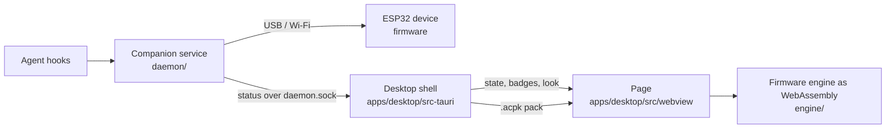

# Desktop Agent Companion - developer notes

The ESP32 Agent Companion's character in a transparent window on the desktop.
The user-facing summary is in the [root README](../README.md#desktop-agent-companion).

## How the pieces fit



There is one of everything:

- **One animation engine.** [`engine/engine.cpp`](engine/engine.cpp) compiles the
  firmware's own `CharacterMotion`, `SpriteMotion`, `SpriteRenderer`,
  `FullFrameRenderer`, `CharacterEffects` and `AgentBadges` from
  [`../firmware/AgentCompanion/src`](../firmware/AgentCompanion/src) to
  WebAssembly, unchanged. The wrapper does only what `AgentCompanion.ino` does
  around them: it owns the frame buffers, applies mode changes, and steps the
  engine once per frame.
- **One kind of pack.** The page loads the same `.acpk` file the device installs,
  from `build/characters` or from the characters added in Settings.
- **One source of truth.** The Rust shell polls the daemon's `status` every
  400 ms. That gives it the state, the agent badges (already filtered by the
  badge setting and cut to four, as the device gets them), the character and its
  pack file, and the desktop settings (shown or hidden, and the look). The desktop has no hooks, no state
  coordinator and no settings of its own.

## Building

```bash
python3 tools/character_pack.py build   # from the repository root: the .acpk packs
cd desktop
npm install
npm start            # builds the page and app icon, then cargo run --release
npm test             # typecheck, engine freshness, parity and cut-out tests
npm run bundle -w @agent-companion/desktop   # the installable app, without the service
```

### The bundled companion service

Release builds for macOS, Windows, and Linux carry the daemon, so a user needs only the
app. To build one as a release does:

```bash
cd desktop/apps/desktop
node scripts/bundle-daemon.mjs --target universal-apple-darwin   # or no --target, for this computer
npm run bundle -- --target universal-apple-darwin --config src-tauri/tauri.daemon.conf.json
```

- [`scripts/bundle-daemon.mjs`](apps/desktop/scripts/bundle-daemon.mjs) builds
  the daemon and puts it in `src-tauri/daemon-runtime` (ignored by Git), with
  its production dependencies, the packs from `build/characters`, `VERSION`, and
  the official Node.js binary, checked against its `SHASUMS256.txt`. Node.js is
  about 128 MB for each architecture, and the universal macOS build has two.
  In CI, the packs come from the release's `-characters.zip`, and
  `--release-firmware <firmware.zip>` records the release firmware ID in
  `RELEASE_FIRMWARE_ID`, so Settings can show that a firmware update is available.
- [`tauri.daemon.conf.json`](apps/desktop/src-tauri/tauri.daemon.conf.json)
  adds that folder to the app's resources. A build without it (`npm start`,
  `cargo run`) carries no service and never installs one.
- [`service.rs`](apps/desktop/src-tauri/src/service.rs) runs at start. The
  daemon's `status` has `service: {root, version}`, the folder it runs from and
  its `VERSION`. If no daemon answers within 10 s, the app copies the resource to
  `<data folder>/runtime`, runs its `install.js` with the user's login-shell
  `PATH` and `--desktop`, and opens setup for a new installation. New setup does
  not install agent hooks before approval. If the daemon from `runtime` runs at another
  version, it copies and installs again. It leaves a daemon from any other folder,
  such as a clone, alone.
- The running app has a macOS Dock entry and taskbar entries on Windows and
  supported Linux desktops. Reopening the app restores an existing Settings
  window before the character, without changing its tab or setup progress.
  Windows and Linux desktops with a taskbar minimize a hidden character rather
  than removing its taskbar entry. Hyprland, including Omarchy, hides the
  character and keeps the menu-bar tray entry. If the character is disabled,
  app activation opens Settings.
  On Windows, an open Settings window owns the taskbar entry. The character
  returns to the taskbar when Settings closes. A taskbar click does not need
  a window picker.
  On macOS, the app uses regular activation. The character uses
  `CanJoinAllApplications` on macOS 13 or later to retain its full-screen overlay.
  Older macOS versions retain normal Spaces behavior but cannot overlay other
  apps' full-screen Spaces. Native quit and taskbar-close actions use the same
  installation guard and service-stop rules as the tray.
  A character click or focus transfer after minimizing Settings does not
  restore Settings. Hyprland finds the character by its process and initial
  window title. The startup dialog uses a separate title, so Hyprland does not
  float or pin Settings or the startup dialog. Equal size bounds retain
  the configured 280 by 280 character size through initial tiling and Hide/Show.
  The bundled runtime includes only the three characters in
  [`built-in.json`](../characters/built-in.json). Add-on packs are imported
  separately and are not bundled from cached build output.
- [`onboarding.ts`](../daemon/src/onboarding.ts) saves setup progress in
  `onboarding.json` in the daemon's data folder. Missing records belong to older
  installations; the desktop installer explicitly creates an incomplete record
  for new users. The app reopens incomplete setup on launch. **Finish** saves
  completion before showing Settings. The shared setup view is in
  [`daemon/web`](../daemon/web), with the website's colors and typography.
  Malformed progress opens a fresh setup with an error and keeps the damaged
  file before replacing it. Setup mutations own an async operation lock;
  conflicting Settings and CLI mutations are rejected, while internal setup
  actions keep the same ownership. Saved USB ports follow character and
  firmware restarts. A live Wi-Fi connection clears a stale USB choice.
  Settings shows activity, device status, and usage in a compact overview.
  A thin, muted blue border highlights the overview on every Settings tab.
  Settings tabs use one outer panel with open sections and borderless setting
  rows. Light dividers separate sections and rows. Input controls and selected
  characters or active agents retain their borders.
  Connection details and versions are collapsed below it. Connection mode
  controls live on the Device tab, and Run setup wizard opens onboarding.
  Welcome uses bundled artwork from the website, not a thumbnail from the user's
  selected character pack, so custom characters do not change the welcome graphic.
  Welcome shows only the title, one short description, the animation, and
  Get Started. Service and privacy details are collapsed on the Agents step.
  The character is vertically centered between the welcome title and
  description and the footer divider.
  Flexible spacing uses the available height and retains scrolling on small screens.
  The website's idle clip loops inside the device case. It pauses outside Welcome
  and uses the still image when reduced motion is enabled.
  Each step enters with a 200 ms fade and a 6-pixel upward movement.
  Reduced motion disables the transition. Status updates do not replay it.
  Ready shows compact read-only agent cards and the selected character inside
  the desktop/device preview. Connection graphics use the actual USB or Wi-Fi
  transport. Deferred or disconnected devices are not shown as connected.
  Agent cards distinguish received activity from pending approval or setup.
  The Ready device uses the website's shell artwork and a local idle preview
  from the same WebAssembly engine and selected `.acpk` pack as the desktop.
  Playback runs only in the visible Display, Device, or Ready device preview.
  It stops on other steps, when the window is hidden, and for reduced motion.
  The selected character's still image remains available as a fallback.
  Failed animation loads can retry when the preview is opened again or the
  service reconnects. Character changes reallocate the frame buffer for the
  pack's dimensions. A catalog revision refreshes other open Settings windows
  when packs are added or removed.
  Preview-pack downloads require the Settings token and do not change the device.
  Settings and setup share a window with a preferred size of 1300 by 1118
  logical pixels, 30 percent larger than the previous launch size. The shell
  centers it in the companion's monitor work area and limits its size for the
  menu bar, taskbar, Dock, window frame, and display scaling.
  The display step keeps a consistent gap between its choices and preview.
  Shorter windows scroll instead of reducing that gap. Overflow keeps a thin
  scrollbar, while Back and Next stay visible outside the scroll area.
  The display and device-preparation steps share the laptop-and-device
  graphic. It shows the active Wi-Fi connection or the USB cable.
  Display choices, Display, device preparation, and Ready reuse one complete
  scene, including the laptop, website device shell, and selected character.
  Desktop only shows the character inside the device shell on the laptop screen.
  One animation renderer follows the visible device preview without downloading
  the selected pack again when the wizard changes steps.
  Device-preparation buttons are centered below the graphic.
  The navigation opens previously reached steps with mouse or keyboard input.
  Agent-selection cards remain available during connection checks. A needed
  connection guide appears below the cards, not in place of them.
  If every selected agent is connected, Next moves directly to Character
  after checking the hooks, without an extra connection confirmation.
  `visitedSteps` persists that history across restarts and reruns. Future steps
  remain disabled, and the service rejects navigation during an installation.
  Wizard headings, status messages, and standalone actions are centered.
  Instruction lists and field labels remain left-aligned; progress labels
  and values stay at opposite ends of their row.
  Character installation is labeled separately from firmware replacement.
  Device-model confirmation appears only in the firmware-install dialog.
  During setup, the view shows only the active installation and keeps its
  connection graphic stable while the device restarts.
- `agents.json` records approved hook installations. Desktop updates only repair
  approved, enabled hooks. Explicit `npm run setup` keeps its detected-agent
  behavior and still respects hooks the user removed.
  Setup checks selected hooks before it requests installation approval.
  Current hooks stay unchanged, including hooks that need agent-side approval.
  Only missing or outdated hooks are installed or updated after approval.
  The service checks again before changes and rejects newly required,
  unapproved installations.
  All six agent guides update from the live status stream and require actual
  agent activity. Setup also recognizes an active Wi-Fi device and can reuse
  its firmware without USB. Only firmware installation or replacement in
  the wizard requires a USB device.
- Quit stops the service too when the daemon's status has `deviceUsed: false`
  (no USB device has connected and there is no Wi-Fi pairing) and the app carries
  the service. **Quit and Stop Companion Service** in the tray, and **Stop** in
  Settings, send `stopService`: the device goes idle, the app closes, and the
  daemon stops through its service manager. The daemon leaves a `service-stopped`
  file in its data folder until it runs again, so the next start of the app
  installs the service at once and does not wait 10 s for a service manager.
  Desktop-only mode also stops the service with the bundled app, even when the
  computer used a physical device before. Quit, Stop, and Restart wait for an
  active setup or firmware installation to finish.
  App updates do not replace the runtime while setup or installation is active.
  The `--quit` command does not start a missing app service.
- The hook installers replace the hooks of any companion install (a path that
  ends in `daemon/dist/src/cli.js`), so a change between a clone and the app's
  copy never leaves two sets of hooks.

### Firmware installs over USB

The app's binary also installs firmware. With `--flash-firmware <folder> --port
<port> [--pid <hex>]`, [`flasher.rs`](apps/desktop/src-tauri/src/flasher.rs) runs
before Tauri starts, opens no window, writes the release in `<folder>` to the
device with espflash, and exits. The daemon starts this mode from the
**Device** tab in Settings (**Update to v<version>** or **USB release install or recovery**); see
[Firmware installs over USB](../docs/development.md#firmware-installs-over-usb).
Every build of the app has this mode, also a build without the bundled service.

The engine is committed, in [`engine/prebuilt`](engine/prebuilt): one 110 KB
JavaScript file with the WebAssembly embedded, so the app builds with Rust and
Node alone. Only a change to the engine or to the firmware's animation code needs
a rebuild, with Emscripten (`em++` on `PATH`: `brew install emscripten` on
macOS, or [emscripten.org](https://emscripten.org)):

```bash
npm run build:engine   # then commit desktop/engine/prebuilt
```

`engine/prebuilt/sources.sha256` records what it was built from: the sources
that `engine/build.mjs` compiles, every header they include, and the build
scripts. A test fails until it is rebuilt after such a change. Firmware files
that the engine does not include, such as Wi-Fi or USB code, need no rebuild. Tagged releases build the app for
macOS (universal `.dmg`), Windows (installer) and Linux (x86_64 AppImage and
`.deb`) and attach it to the GitHub Release, with first-run steps for each.

## Matching the device exactly

[`engine/test/parity.test.mjs`](engine/test/parity.test.mjs) builds the
repository's native character preview (`tools/character_preview.cpp`: the same
firmware sources, compiled for the host). It runs that beside the WebAssembly
engine with the same seed, and steps both through idle, working, attention,
complete, surprise and idle again. It checks that every pixel of every frame
matches, for Copilot, Claude and OpenClaw. Any change to the firmware's
animation code reaches the desktop at the next build, and CI fails if the two
ever disagree.
The host preview uses binary output on Windows. Windows validation uses an
existing C++ compiler and zlib; the test writes a `.exe` there.

## The look

By default, the window is a small copy of the device: the round screen in a
matte black case, with the two buttons on its right edge. Light from the top
left catches the case's rim and the bevel into the screen. The page draws the
case in the canvas around the engine's frame, and the frame is the device's own
pixels on its own black screen, so it reads exactly as the device does.

With **Show the device around the character** turned off, the character sits straight on the desktop, so the
engine keys the frame (`writeRgba` in `engine.cpp`):

- Black that connects to the edge of the round display is background. Black
  that the art encloses (inside a face) is kept. This is a flood fill from the
  edges, so dark seams and shadowed interiors survive however dark they are.
- The engine renders the character, keeps a copy, then renders the effects.
  Pixels that the effects changed over the background get their brightness
  back as alpha, because the device blends effects against black. A fading
  digit is then a fading digit, not a dark smudge.
- The badge disc's dark fill stays opaque, as it is on the device.

## Keeping it light

A desktop pet runs all day, so it is measured, not assumed. These are the
figures on an Apple Silicon Mac (release build, all four processes the app
uses, WebKit's included), as a share of one CPU core:

| State | CPU | Memory |
| --- | --- | --- |
| Idle | about 3% | 35 MB app, 43 MB page, 7 MB network, 245 MB WebKit GPU |
| Working (effects every frame) | about 7% | the same, flat over a 4-minute soak |
| Hidden | 0.3% | WebKit's GPU memory drops to 16 MB |

What keeps it there:
- **30 frames a second, as on the device** (`kTargetFps`), on a timer, not at
  the display's refresh rate, which can be 120 Hz.
- **Only what changed is converted and uploaded.** The engine compares each
  frame with the last in 32x32 tiles, converts only changed tiles, and lists
  them as rectangles; the page uploads only those to one WebGL2 texture. An
  unchanged frame costs one engine step and nothing else.
- **Premultiplied pixels.** The engine writes what the GPU composites, so
  WebKit does not convert each upload, which profiling showed was its hottest
  path. A 2D canvas fed by `putImageData` cost a new GPU surface per frame
  (about 400 MB of GPU memory, and more CPU); a per-frame `ImageBitmap` was
  worse still. WebGL 1 and a 2D canvas remain only as fallbacks.
- **A lost WebGL context comes back.** The system can take the context away, for
  example after sleep or when WebKit's GPU process restarts, and every draw then
  does nothing. The presenter asks for the context back, rebuilds its texture
  when it returns, and the page sends a whole frame. Before this, the character
  vanished inside the case until the app restarted.
- **The frame is shown at its own size**, scaled by CSS, and **the case is
  drawn once per size** on its own canvas.
- **The "character only" cut-out is cached** while only the effects move; a
  test checks it matches a fresh cut-out.
- **The pack is held once.** The page writes it straight into the engine.
- **A small shell.** One async worker instead of one per core. On macOS the
  cursor is read from Core Graphics, not through the main thread; the window's
  place comes from window events. The cursor is checked 20 times a second near
  the window, 7 times far from it, and once a second while hidden.
- **Hidden means stopped**: no engine steps and no drawing.

The floor is WebKit's: about 240 MB of GPU memory while anything on the page
animates, which it releases when nothing does. Going below that would mean a
native renderer instead of a WebView.

## Credits and licensing

The Desktop Agent Companion is by Darren Robinson, made with Dan Wahlin's
approval. The window itself (the transparent, click-through, draggable pet with
its tray, placement memory and multi-monitor checks) is his work, in
[apps/desktop](apps/desktop/README.md). The animation engine is the ESP32
Agent Companion firmware.

The code is under the repository's [MIT License](../LICENSE). The MIT License
does not cover the characters: `copilot` renders a character of GitHub's,
`claude` one of Anthropic's and `openclaw` one of the OpenClaw project's. See
[TRADEMARKS.md](../TRADEMARKS.md).
